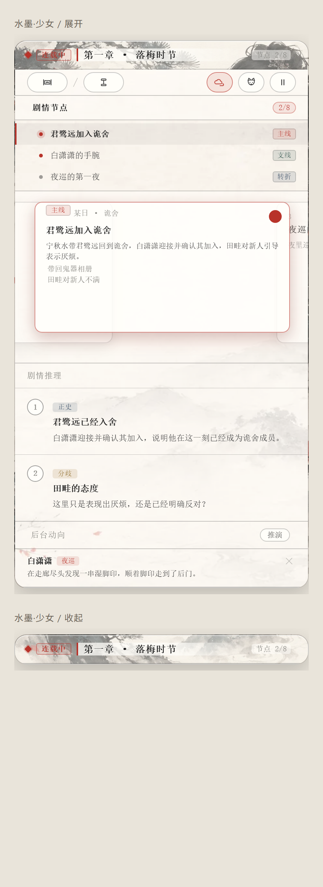
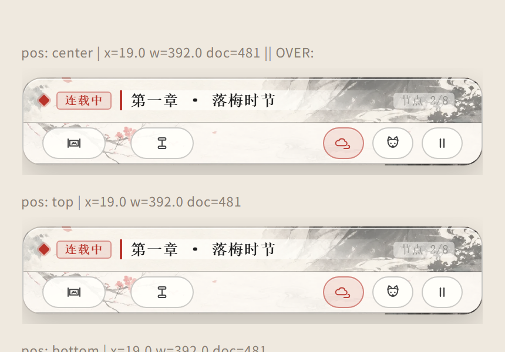

# 状态栏·水墨皮肤（ni-bar-bg）

给 **novel-injector** 的状态栏面板整条换皮：底图、标题牌、状态药丸、按钮、卡片、标签、滚动条，
全部换成「动漫水墨国风」。**不修改 novel-injector 的任何文件**，所以它更新时不会把皮肤冲掉。

## 效果

展开态：



收起态（露出底图装饰，标题有宣纸小牌保证可读）：



## 安装

把整个 `ni-bar-bg` 文件夹放进：

```
SillyTavern/public/scripts/extensions/third-party/ni-bar-bg/
```

（安卓手机酒馆一般是 `Android/data/.../files/.../public/scripts/extensions/third-party/`，
找不到就用酒馆自带的「安装扩展 → 从文件夹/压缩包」功能。）

放好后刷新页面，在「扩展设置」里能看到 **状态栏·水墨皮肤** 这一栏。

## 用法

- **启用**：总开关，关掉就完全恢复原样（不改任何插件文件）。
- **皮肤预设**：黑白·抱猫（默认）/ 水墨·少女 / 水墨·山水 / 水墨·背影 / 夜墨 / 樱粉 / 素纸，点一下立即生效。
- **自定义底图**：上传本地图片，或填一个图片直链。上传的图会先在浏览器里压成 webp 再存，
  不会撑爆设置文件；建议竖版（2:3），主体偏上方或偏下方一点更好看。
- **文字深浅**：浅色底配墨字，深色底配米字；换图后如觉得字看不清就切一下。
- **底图位置**：收起状态条时露哪一段画面（默认「靠上」，展开后会自动居中）。
- **纸底浓淡 / 压暗 / 模糊 / 圆角**：四个滑杆，实时生效。
- **按角色卡分别设置**：打开后，当前角色卡（按头像区分）会有独立的底图与配色；
  不想单独设的角色走全局设置。

## 图标按钮

「阶段 / 节点 / 自动 / 推演 / 暂停」这几个按钮的文字已换成水墨线描图案：

| 按钮 | 图案 |
| --- | --- |
| 阶段 | 画卷 |
| 节点 | 卷轴 |
| 自动 | 云纹 |
| 推演 | 狐狸头 |
| 暂停 / 继续 | 双竖 / 三角 |

图标用 CSS mask 实现，颜色跟随按钮文字色，所以点亮或 hover 时会自动转成朱砂色。
想换图案只要改 `style.css` 末尾 `NI-ICONS` 那段里的 SVG。

## 说明

- 皮肤只作用于 `#ni-storybar` 这一个面板，聊天正文、其他界面一律不动。
- 状态栏是插件动态插入的，本扩展用 MutationObserver 跟随重绘；切聊天 / 切角色 / 下拉刷新后都会自动重新套上。
- 所有设置存在浏览器 `localStorage`（键 `ni-bar-bg/v1`），不写进酒馆的 settings.json。

## 目录

```
ni-bar-bg/
├── manifest.json
├── index.js          设置读取 / CSS 变量注入 / 按角色切换
├── style.css         整套水墨皮肤 + 图标按钮（约 820 行）
├── settings.html     设置面板
└── assets/           内置底图（webp）
    ├── ink-bw.webp     黑白·抱猫（默认，1024×1536）
    ├── paper-bw.webp   内容区宣纸底纹（1200×800）
    ├── ink.webp        水墨·少女
    ├── ink-clean.webp  水墨·山水
    ├── ink-back.webp   水墨·背影
    ├── night.webp      夜墨
    └── sakura.webp     樱粉
```
